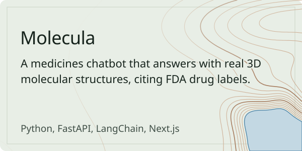
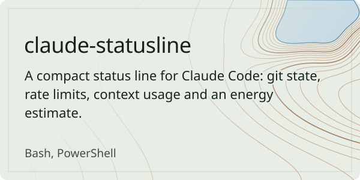
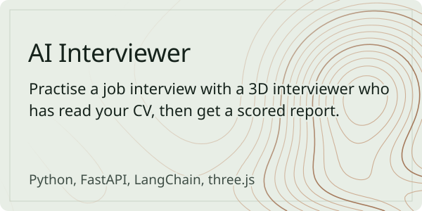
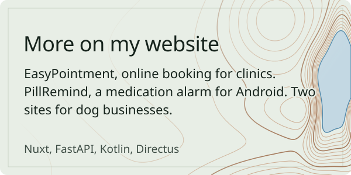

<picture>
  <source media="(prefers-color-scheme: dark)" srcset="assets/header-dark.svg">
  
</picture>

  
  
  

Since 2023 I've mostly built maps: web GIS for wind-park planning at Caeli Wind, and a mapping platform for public agencies at Qntrol. These days I build apps on language models: RAG, agents and tools, evals, voice. I'm doing the AI Engineering specialization at Turing College and building **Bleep**, an on-call agent for Docker hosts that notices incidents, works out why, and asks before it fixes anything. It goes public soon.

### Projects

<table>
  <tr>
    <td width="50%" valign="top">
      <a href="https://github.com/DannyKuk/molecula"><picture>
        <source media="(prefers-color-scheme: dark)" srcset="assets/molecula-dark.svg">
        
      </picture></a>
      <a href="https://molecula.dkwebsite.de">Live demo</a> &nbsp; <a href="https://dkwebsite.de/projects/molecula">Case study</a>
        
      <a href="https://github.com/DannyKuk/claude-statusline"><picture>
        <source media="(prefers-color-scheme: dark)" srcset="assets/claude-statusline-dark.svg">
        
      </picture></a>
      <a href="https://github.com/DannyKuk/claude-statusline#install">Install</a>
    </td>
    <td width="50%" valign="top">
      <a href="https://github.com/DannyKuk/ai-interview"><picture>
        <source media="(prefers-color-scheme: dark)" srcset="assets/ai-interview-dark.svg">
        
      </picture></a>
      <a href="https://dkwebsite.de/projects/ai-interviewer">Case study</a>
        
      <a href="https://dkwebsite.de/#projects"><picture>
        <source media="(prefers-color-scheme: dark)" srcset="assets/more-dark.svg">
        
      </picture></a>
      <a href="https://dkwebsite.de/projects/easypointment">EasyPointment</a> &nbsp; <a href="https://dkwebsite.de/projects/pillremind">PillRemind</a> &nbsp; <a href="https://dkwebsite.de/projects/toivoa-tassuille">Toivoa Tassuille</a> &nbsp; <a href="https://dkwebsite.de/projects/kennel-unlock">Kennel Unlock</a>
    </td>
  </tr>
</table>

### What I work with

**Languages:** TypeScript, Python, Kotlin, SQL 
**Web:** Vue and Nuxt, React and Next.js, FastAPI, Spring Boot, PostgreSQL with PostGIS, Mapbox 
**AI:** LangChain, RAG, agents and tools, MCP, evals, speech-to-text and TTS 
**Ops:** Docker, Azure, GitHub Actions, Linux
